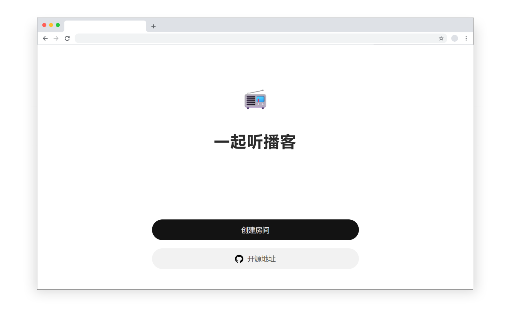
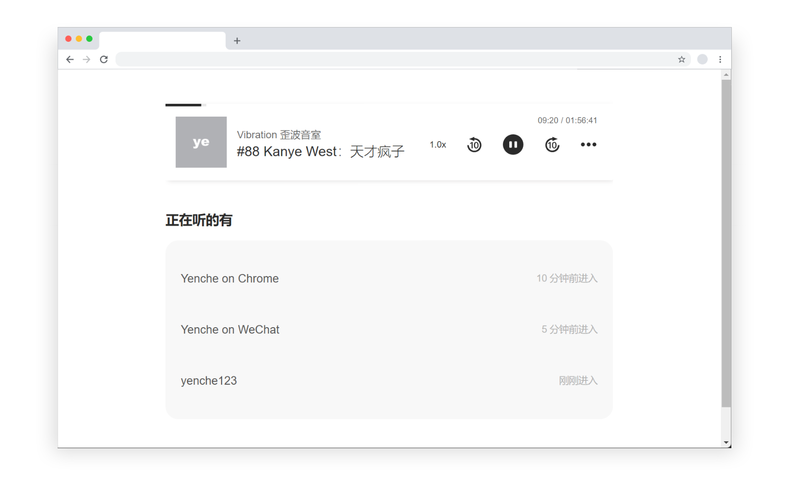
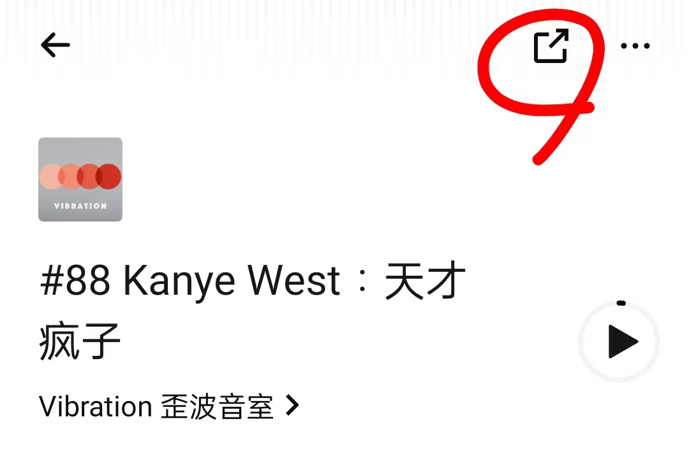
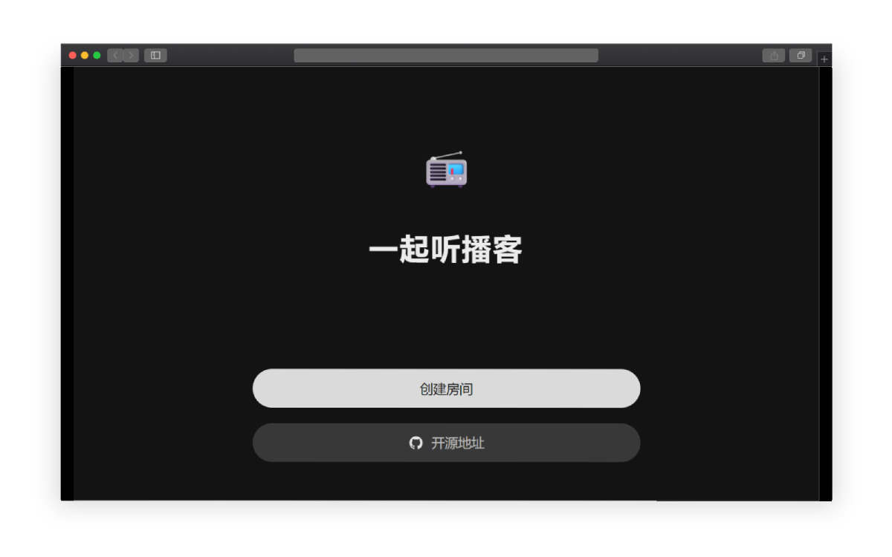
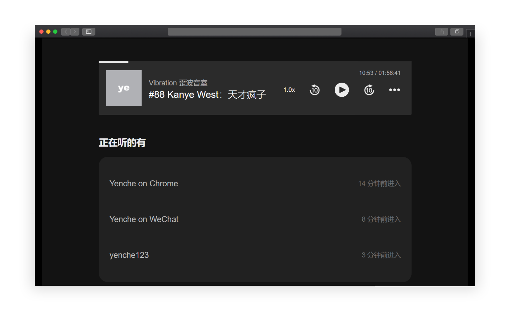
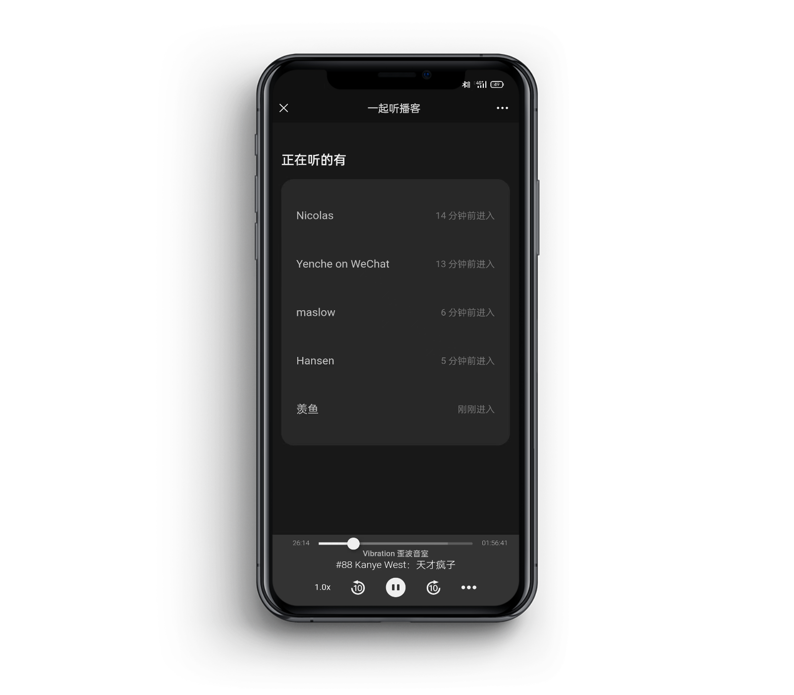
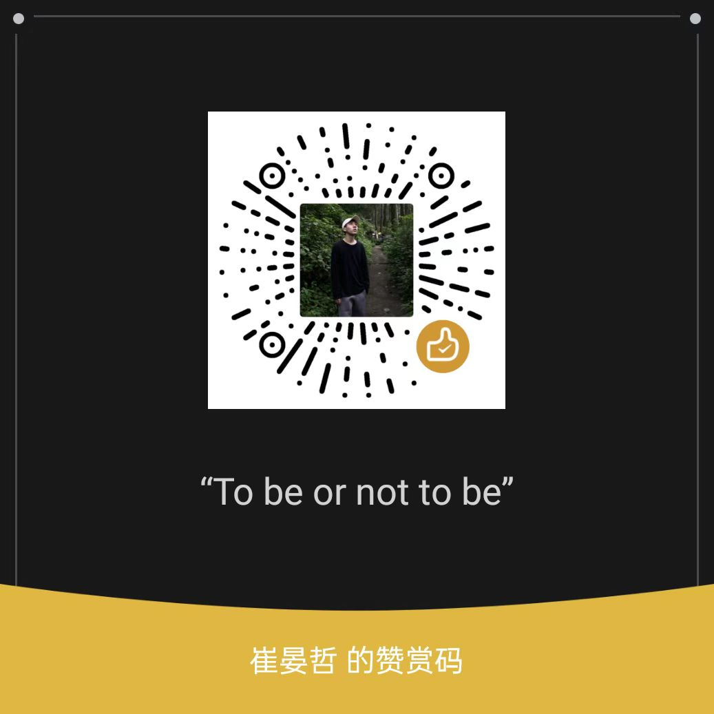

# 一起听播客





> 跟你的好友一起实时连线听播客！

<br>

## 😎 如何使用

1. 打开小宇宙 App，在单集详情页，点击屏幕右上角的分享按钮（如下图所示），再点击复制链接。



2. 访问 [https://podcastogether.com/](https://podcastogether.com/) 创建房间，依页面的提示黏贴上一步复制到的链接，即可创建能跟好友一起实时聆听的播客房间啦！

详情参见[使用指南](https://yenche.zhubai.love/posts/2172097942360440832)

<br>

## 🎧 介绍

网易云音乐能一起听歌却不支持一起听 Podcast，小宇宙也不支持，Spotify 需要成为会员才能一起听......

百度了一下，没有人提供这项服务，我就只好自己开发了🥲

### 1 无需登录，直接听

输入昵称，就可以进入房间，跟好友一起听啦！目前最多支持 15 人同时一起听。

### 2 支持小宇宙 / Apple Podcast 中国区

目前已知支持 `xiaoyuzhoufm.com/episode/` 或者 `podcasts.apple.com/cn/` 的链接（不支持短链），后者解析稍慢是正常的，如果解析失败不妨稍后再尝试。

另外，还支持 https 协议的 CDN 链接，也就是你上传 `.mp3` 文件至任意可公网访问的云上，获得 https 链接后即可黏贴到 [https://podcastogether.com/create](https://podcastogether.com/create) 中一起听。

更多音源详情请参见[这里](https://github.com/yenche123/podcast-together/discussions/3)

### 3 支持深色模式







从一开始就支持深色模式！晚上一起听，再也不亮瞎眼🙈

### 4 没了

功能这么少？一起听，应该如此简单！

<br>


<br>

## 📱 本副本的 iPhone 优化与本地启动

这是在开源项目 [yenche123/podcast-together](https://github.com/yenche123/podcast-together) 上做的**本地优化副本**，没有改原仓库远程。目标是在不破坏桌面 / 安卓用法的前提下，让 iPhone Safari（以及「添加到主屏幕」后的站点）更能稳定地一起听。

小宇宙 App 本身仍然没有「一起听」，也不可能从第三方遥控它的播放器。这里还是：**自己的网页播放器 + 房间同步**。音源继续支持小宇宙单集链接（`xiaoyuzhoufm.com/episode/`，读取页面公开的 `og:audio` 等）、Apple Podcast 中国区，以及直接的 https 音频地址。解析只抓你粘贴的那一页公开信息，不做登录或批量爬取。

### 原项目在 iPhone / 本地上的主要问题

- 后端绑在 Laf 云函数上，没有本地房间服务，仓库拉下来后两个标签无法真正同步。
- PWA 元信息对 iOS 不完整：viewport 有拼写错误（`user-scalabel`）、没有 `viewport-fit=cover`、没有 `apple-mobile-web-app-status-bar-style`、缺少 180×180 的 Apple Touch Icon，也没有安全区适配。
- iOS 必须先有用户手势才能出声，原来要等加载失败后再弹窗，进房 / 晚到不够直观。
- 播放器自带的 Media Session 不尊重「仅房主可操作」，`seekto` 入参也不兼容，锁屏和控制中心容易把房间进度打乱。
- iOS 后台会挂起 `setInterval`、也常断开 WebSocket。原来只在关闭码 1006 时重连，而且 5 秒连不上就把人踢出房间；从后台回来还会先弹出「请稍等」并重进房，容易误打断正在播的音频。
- Safari 不会触发 `beforeinstallprompt`，首页没有「添加到主屏幕」的说明。

### 这个副本改了什么

1. **iOS PWA / 主屏幕**：补全 manifest、180×180 图标、`apple-mobile-web-app-capable` / `status-bar-style`、`viewport-fit=cover`、主题色，以及 `env(safe-area-inset-*)`。
2. **播放解锁**：进房后（尤其是 iPhone）会看到「点击开始同步收听」遮罩，一次点击后对齐房间进度再播放。`<audio>` 设置了 `playsinline`，并挂到页面 DOM 里；只在真正离开房间时销毁播放器，前后台切换不会拆掉它。
3. **锁屏与系统媒体控件**：接入 Media Session（封面 / 标题、play、pause、seek、`setPositionState`）。可以操作播放器时，锁屏控件会同步到房间；若房主限制了「仅房主可操控」，锁屏的暂停只会把**本地静音**，不会改房间进度。
4. **后台 / 恢复同步**：心跳 + 断线自动重连（指数退避）。`visibilitychange` / `pageshow` / `online` / `focus` 时立即拉房间快照并对齐。正在播放时以 `audio.currentTime` 为准，不用被挂起的定时器推算本地进度。重连时若进度已经接近，不会把音频seek回去。时间用 `/pt-service` 做时钟偏移补偿。
5. **iPhone 交互**：更大的点击区、安全区、减少下拉刷新误触；分享继续优先走系统分享面板（Web Share API）。首页在 iPhone Safari 会提示如何添加到主屏幕。

核心体验都保留：粘贴小宇宙链接建房、昵称进房、同步播放 / 暂停 / 倍速 / 进度、仅本人静音、可选仅房主操控。

### 本地启动

需要 Node.js 20+，建议用 pnpm（npm 也可以）。

从仓库根目录运行：

```bash
pnpm install
pnpm dev
```

`pnpm dev` 会同时拉起：

- 本地房间服务：`http://127.0.0.1:8787`（HTTP + WebSocket `/ws`，房间存在内存里）
- Vite 前端：`http://127.0.0.1:5173`（默认会用 mkcert 走 https）

只跑房间服务：`pnpm server`  
只跑前端（需已经有房间服务）：`pnpm dev:vite`  
协议烟测（先开着 `pnpm server`）：`pnpm test:sync`

浏览器打开前端地址后，创建房间时可粘贴小宇宙单集链接；本地没有外网节目时，创建页会给出演示音频地址（`/demo/tone.mp3`），粘贴即可建房。

### 用两个标签测同步

1. 打开 `http://127.0.0.1:5173`（若自动跳到 https，按证书提示继续即可）。
2. 输入昵称，创建一个房间（可用演示音频）。
3. 复制地址栏里的房间链接，再开一个无痕窗口或另一个浏览器，换一个昵称进入同一房间。
4. 在房主一侧点播放、拖进度、改倍速，另一个标签应在约 1 秒内跟上。把其中一个标签切到后台再回来，应自动重连并对齐，而不是把音频重头播放。

### 在 iPhone 上体验

本机开发服务**默认没有公网域名**，真机要访问，可以把手机和电脑连同一 Wi-Fi，用启动日志里打印的局域网地址，例如：

`https://192.168.x.x:5173`

注意：

- 默认开启 mkcert 的 https。iPhone 会提示证书不受信任，需要在电脑上把本地 CA 装到手机，或先忽略（部分能力会受限）。
- 若证书太麻烦，可用 HTTP 启动（PWA「添加到主屏幕」、部分系统能力在非 https 下不可用，但一起听同步仍可测）：

```bash
PT_DEV_HTTPS=0 pnpm dev
```

然后在 iPhone Safari 打开 `http://192.168.x.x:5173`。

- **添加到主屏幕**：用 Safari（不是微信内置浏览器）打开站点 → 底部分享 → 「添加到主屏幕」→ 从桌面图标打开。
- 不要指望用 ngrok / 云主机，除非你自己再配一层；这个副本不会自动对外部署。

### 做不到的限制（iOS 硬限制）

- 锁屏后 JavaScript 定时器和后台 WebSocket 仍可能被系统挂起或杀掉。音频往往还能继续播，但进度对齐要等回到前台后才会再拉快照。
- Screen Wake Lock 不能在锁屏后保活网页；本项目也没有用它来「强行亮屏」，以免听播客时屏幕一直不灭。
- 无法遥控小宇宙官方 App，也不能在第三方里嵌入它的「一起听」。
- 从主屏幕打开的独立 PWA，在部分 iOS 版本上，一集播完后再自动播下一首仍可能失败（本产品一次只听一集，影响较小）。
- iPhone 访问电脑的开发服务，受局域网、防火墙和证书限制，不是已经公开可访问的网站。

## 🧑‍💻 自行构建/部署

非常欢迎自己兜一套减轻我的云服务资源，详情参见[语雀文档](https://www.yuque.com/cuiyanzhe/sx698m/etgegl)

<br>

## ✉️ 联系我

1. Github [讨论区](https://github.com/yenche123/podcast-together/discussions)

2. [Email](mailto:tsuiyenche@outlook.com)

<br>

## 特别鸣谢

以下名单不区分先后顺序。

1. [Vite](https://cn.vitejs.dev/) + [Vue 3](https://staging-cn.vuejs.org/) + [Vue-Router](https://router.vuejs.org/zh/guide/) + [Pinia](https://pinia.vuejs.org/)

你值得拥有的前端工具链

2. [TypeScript](https://github.com/microsoft/TypeScript)

让前端开发具备类型检查的能力。我常阅读[这份指南](https://ts.xcatliu.com/)

3. [Laf](https://www.lafyun.com/)

完全开源的一站式后端开发平台，像写博客一样写代码！

4. [Shikwasa](https://github.com/jessuni/shikwasa)

一个开源、专为播客设计的前端网页播放器。本项目对其做了[定制](https://github.com/yenche123/shikwasa)。

5. [pnpm](https://www.pnpm.cn/)

对 npm 软件包管理器做了一系列改进。

6. [小宇宙](https://www.xiaoyuzhoufm.com/)

感谢小宇宙的单集链接支持 Open-Graph 协议，能获取到 og:audio 的 meta 标签

7. [fluentui-emoji](https://github.com/microsoft/fluentui-emoji)

感谢微软开源的 emoji，非常 Nice!!!

8. [uiball-loaders](https://uiball.com/loaders/)

超好看且好用的加载图标/动画，没有之一。

9. 你

~~谢谢你玩我~~

谢谢你看到这里！

<br>

## 支持我



如果有帮助到你，欢迎向我打赏，请我喝☕

## 开源协议

MIT